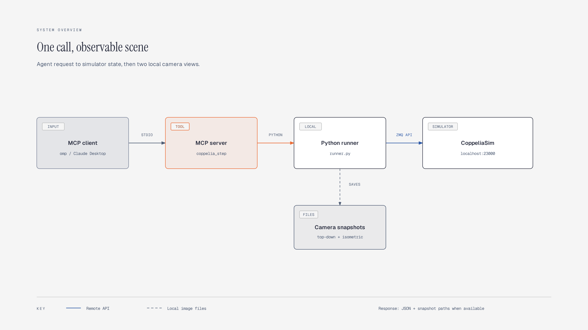
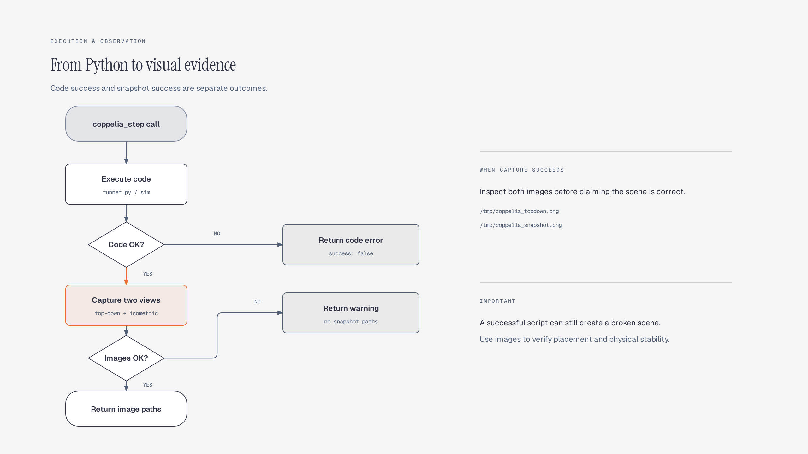

<div align="center">

# CoppeliaSim MCP Server

**Build and inspect CoppeliaSim scenes from an AI assistant through one MCP tool.**

[](LICENSE)

</div>

Connect an MCP client to CoppeliaSim's ZeroMQ Remote API. `coppelia_step` runs Python against the current scene and returns execution output, floor information, scene objects, and paths to top-down and isometric snapshots. The scene persists between calls, so an agent can inspect and refine it without recreating everything.



[View editable architecture diagram](docs/images/architecture.html).

## What you can do

- Create shapes, load bundled robot models by alias, and control simulation with CoppeliaSim's `sim` API.
- Inspect the current floor and scene hierarchy before adding objects.
- Check both camera views after each successful execution: `/tmp/coppelia_topdown.png` and `/tmp/coppelia_snapshot.png`.
- Use the same runner directly from the command line or through an MCP client.

## Get started

### Requirements

- Python 3.10 or newer and [CoppeliaSim](https://www.coppeliarobotics.com/) with its ZeroMQ Remote API addon available on port `23000`.
- A local CoppeliaSim installation with the bundled Python client and robot models. Set `COPPELIASIM_ROOT` to its installation directory if it is not at `/home/myarchlinux/.local/opt/coppeliaSim`.
- An MCP-compatible client for agent use; the command-line runner works without one.

### Install

```bash
git clone https://github.com/nashirabbash/coppeliasim-mcp.git
cd coppeliasim-mcp
bash setup_env.sh
.venv/bin/python -m pip install -e .
```

`setup_env.sh` creates `.venv` and installs runner dependencies; `pip install -e .` also installs the MCP server dependency. Start CoppeliaSim yourself and confirm its ZeroMQ Remote API addon is listening on port `23000`. This is the portable route: automatic launch currently uses installation paths hard-coded for the original author's machine.

For installations elsewhere, set `COPPELIASIM_ROOT` before running the CLI or starting the MCP client (or set it in the client's server environment):

```bash
export COPPELIASIM_ROOT=/path/to/coppeliaSim
```

Try the local runner without changing the scene:

```bash
./coppelia_run --code 'print(get_floor_info())'
```

It prints JSON with `success`, captured output, floor and scene objects, and snapshot paths when image capture succeeds. Open **both** snapshot files to check actual placement; `success: true` only confirms Python code ran, not that geometry or physics is correct. If no simulator is connected, the command reports a connection error instead.

### Connect an MCP client

Find the absolute path to this checkout, then replace `/absolute/path/to/coppeliasim-mcp` below. For `omp`, add this server to `~/.omp/agent/mcp.json` (merge it with existing `mcpServers` entries):

```json
{
  "mcpServers": {
    "coppeliasim": {
      "type": "stdio",
      "command": "/absolute/path/to/coppeliasim-mcp/.venv/bin/python",
      "args": ["/absolute/path/to/coppeliasim-mcp/coppelia_mcp.py"],
      "enabled": true
    }
  }
}
```

For Claude Desktop, use its `claude_desktop_config.json` (`~/.config/Claude/` on Linux or `~/Library/Application Support/Claude/` on macOS) with the same `command` and `args` under `mcpServers`; omit `type` and `enabled`. Other stdio MCP clients can use the same executable and script paths. Restart your client after editing its configuration.

## Use the tool

Ask your client to call `coppelia_step` with Python source in `code`. Example:

```python
# coppelia_step(code="...")
print(get_floor_info())
print(get_scene_hierarchy())
robot = load_robot('pioneer', [0.0, 0.0, 0.3])
print(sim.getObjectPosition(robot, -1))
```

Check `scene_objects` first so repeated calls do not load another copy of the robot. `load_robot` uses `.ttm` models under `COPPELIASIM_ROOT/models`; aliases include `pioneer`, `youbot`, `hexapod`, `ant_hexapod`, `omni`, `quadcopter`, `epuck`, `vacuum`, `panda`, `ur5`, and `ur10`. Available models depend on your CoppeliaSim installation; run `./coppelia_run --list-robots` for the full alias map.

| Parameter | Default | Behavior |
| --- | --- | --- |
| `code` | `""` | Python executed with `sim`, `client`, `simIK`, `simOMPL`, `load_robot`, `get_floor_info`, `get_scene_hierarchy`, and snapshot helpers. Empty code captures the current scene. |
| `reset` | `false` | Stops a running simulation before executing code; **does not clear scene objects**. |
| `headless` | `false` | Requests headless mode only if the server needs to launch CoppeliaSim. |

Response is JSON text containing `success`, `stdout`, and, when available, `stderr`, `error`, `floor`, `scene_objects`, `snapshot`, and `topdown_snapshot`. Snapshot paths are omitted if capture fails. Inspect both views before treating a scene as finished.



[View editable execution-flow diagram](docs/images/execution-flow.html).

### Command-line runner

```bash
./coppelia_run --code 'print(get_scene_hierarchy())'
./coppelia_run --file path/to/scene.py
./coppelia_run --reset --code 'sim.startSimulation()'
```

Runner accepts `--host` and `--port` for an existing remote simulator; MCP tool uses its default localhost port `23000`. `--reset` stops simulation, not object removal. For CLI options, run `./coppelia_run --help`.

## Troubleshooting

- **Cannot connect to `localhost:23000`:** Start CoppeliaSim, enable its ZeroMQ Remote API addon, and verify port `23000`. Automatic launch scripts assume author-specific absolute paths; launch manually on other machines.
- **`Failed to import coppeliasim_zmqremoteapi_client`:** Check `COPPELIASIM_ROOT` points to the CoppeliaSim directory containing `programming/zmqRemoteApi/clients/python/src`, then rerun with the project virtual environment.
- **Robot model not found:** Check the model exists beneath `COPPELIASIM_ROOT/models`. Use `./coppelia_run --list-robots` to inspect alias paths or pass an existing `.ttm` path to `load_robot`.
- **No snapshots:** Check `stderr` in the tool response. Snapshots are written to `/tmp` only after successful code execution and capture; they are local to the machine running the server.

## Contributing

Issues and pull requests are welcome at [github.com/nashirabbash/coppeliasim-mcp](https://github.com/nashirabbash/coppeliasim-mcp). For local development, use the install steps above and verify basic CLI behavior with `./coppelia_run --list-robots`. A live simulator is required to verify scene changes and camera output. The optional `./run_benchmark.sh` exercises agent-driven scenes and requires a configured `omp` client; it changes the active simulation, so use a disposable scene.

## License

[MIT](LICENSE).
